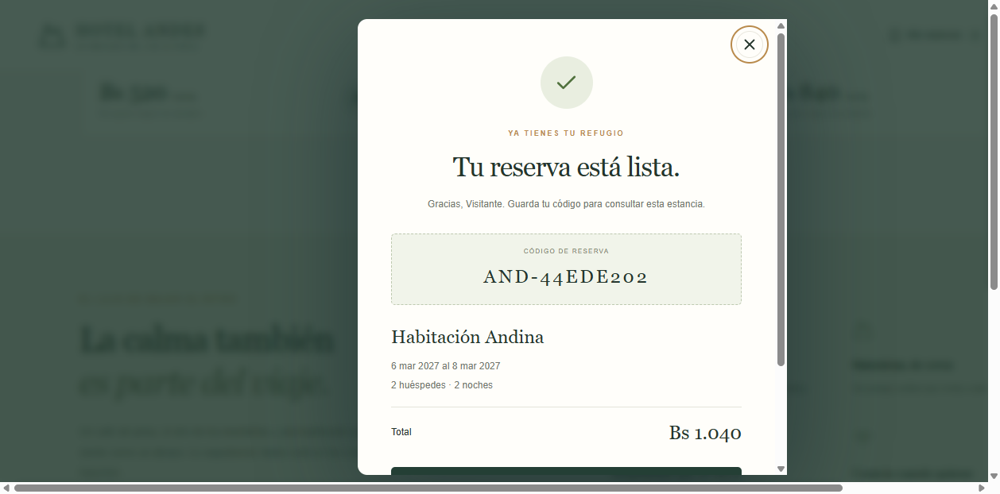
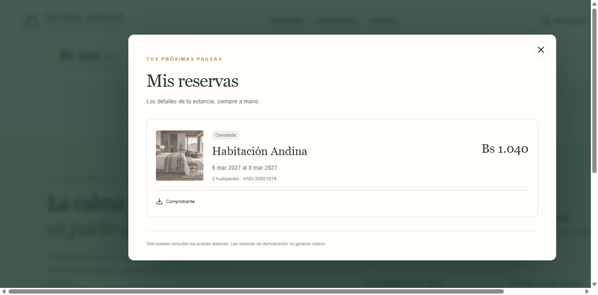

# Auditoría interna de calidad de Hotel Andes

Revisión técnica del prototipo y de las evidencias del Sprint SQA 01. El objetivo es comprobar la trazabilidad exigida por la actividad, registrar desviaciones y verificar las correcciones.

| Dato | Detalle |
| --- | --- |
| Fecha | 27 de octubre de 2026 |
| Equipo | Josue Padilla, Santiago Roca y Karen Caral |
| Objeto | Código, pruebas, configuración, repositorio y tablero |
| Referencia | Plan SQA web y Test Plan SQA HA 1.0 |
| Modalidad | Inspección técnica y ejecución de pruebas; validación grupal pendiente |

## Conclusión de la revisión

Las pruebas finales locales aprueban las reglas y los recorridos incluidos en el plan. Se incorporaron las dos herramientas de aceptación requeridas, trazabilidad, tablero y CI. El avance es demostrable como proyecto académico. Antes del cierre del sprint, los tres integrantes deben revisar la documentación y el acceso del docente.

| Hallazgo | Observación y acción | Estado |
| --- | --- | --- |
| A01 Trazabilidad | Formalizar historias, once criterios y su relación con pruebas; incorporar matriz CSV y plan. | Corregido documentalmente |
| A02 Automatización | Existían pruebas Node. Añadir Cypress y Selenium con reportes y capturas. | Verificado en local |
| A03 Entorno local | Con Wrangler 4.92 se reprodujeron respuestas 503 y cierre de la vista previa. Actualizar runtime y adaptar configuración generada. | Verificado tras corrección |
| A04 Sincronización de pruebas | Selenium consultaba texto antes de terminar la apertura del diálogo; el fallo afectaba casos posteriores. Añadir espera explícita y recarga por caso. | 4 de 4 aprobados |
| A05 Seguimiento y CI | Crear tablero con enlaces de evidencia y configurar integración continua en el repositorio. | Tablero creado; CI aprobada |
| A06 Aceptación grupal | Confirmar roles, revisar resultados e invitar al docente si necesita acceso al tablero privado. | Pendiente en QA04 |

## Acciones correctivas y comprobación

A03 se atendió con Wrangler 4.154.0 y tipos de Workers compatibles. Vinext emitía legacy_env, campo que la versión nueva ya no admite; scripts/normalize-wrangler.mjs lo elimina del archivo generado sin cambiar la lógica de reservas. Se repitieron tipos, compilación, API y aceptación sobre el entorno corregido.

El error de entorno se registró por su comportamiento observado. La aprobación de las pruebas posteriores acredita que dejó de reproducirse en la ejecución final, sin atribuir una causa interna no demostrada. Los intentos anteriores se conservaron por separado para el seguimiento de la corrección.

A04 se corrigió esperando explícitamente el texto del diálogo e iniciando cada comprobación desde una página recargada. La prueba móvil emula 390 por 844 píxeles; no depende del ancho mínimo de una ventana de escritorio.

| Verificación final local | Resultado | Registro |
| --- | --- | --- |
| Reglas unitarias | 8 aprobadas, 0 fallidas | evidence/node/unit.log |
| API y D1 | 6 grupos aprobados | evidence/node/api.log |
| Cypress en Chrome | 6 aprobados, 0 omitidos | evidence/cypress/results.json |
| Selenium en Chrome | 4 aprobados | evidence/selenium/results.json |
| Tipos y compilación | Sin error | evidence/verification.json y build.log |
| Criterios de aceptación | 11 de 11 con evidencia | docs/sqa/matriz_trazabilidad.csv |

## Observaciones abiertas y mejora

QA04 mantiene pendiente la revisión real del grupo. MEJ01 propone accesibilidad y rendimiento; MEJ02 añade cobertura de código y seguimiento de velocidad. Estas mejoras no se presentan como pruebas ejecutadas. El análisis no certifica seguridad completa ni preparación para huéspedes reales.

Los responsables de seguimiento se proponen en el plan: Josue para entrega y acceso, Santiago para entorno e integración, y Karen para trazabilidad y métricas. La revisión final debe registrar acuerdos y aceptar o ajustar esa distribución.

## Enlaces verificables

Repositorio: https://github.com/JosuePadillaUnivalle/Hotel-Andes

Tablero: https://trello.com/b/VOKoZIGB/hotel-andes-scrum-y-plan-sqa

GitHub Actions: https://github.com/JosuePadillaUnivalle/Hotel-Andes/actions/runs/40578393966

## Evidencias visuales de aceptación

Capturas originales de la ejecución Cypress en Chrome del 27/10/2026. Los archivos JSON y logs conservan el detalle de cada ejecución. Las capturas complementan las aserciones automáticas.

La carpeta de evidencia incluye además disponibilidad, catálogo, filtros y vista móvil. El tablero y la ejecución remota se documentan con su exportación y enlaces.
